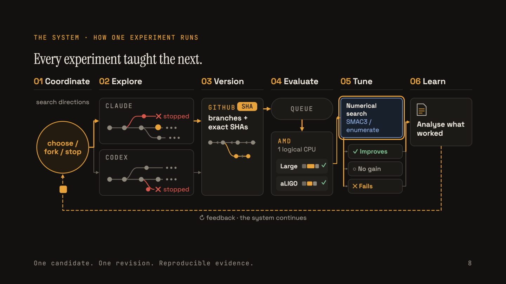

# Faster Answers · Search Observatory

**The graph behind the experiments.** Follow ideas through agent sessions, exact Git revisions, benchmark runs, and recorded decisions.

[**Combined project ↗**](https://github.com/timbtz/feyer-search-lab#readme) · [**Final presentation ↗**](https://github.com/timbtz/feyer-search-lab/blob/main/presentation/faster-answers.pdf) · [**Feyer’s introduction ↗**](https://github.com/timbtz/feyer-search-lab/blob/main/presentation/feyer-challenge.pdf)

[](https://github.com/timbtz/feyer-search-lab/blob/main/docs/ARCHITECTURE.md)

*Recorded experiment snapshot. Expand sessions to inspect candidates and their individual runs.*

## The operating loop

[](https://github.com/timbtz/feyer-search-lab/blob/main/presentation/faster-answers.pdf#page=8)

| [Challenge lab](https://github.com/timbtz/feyer-search-lab) | This frontend |
| --- | --- |
| Operates agents, Git provenance, evaluation, and feedback | Visualizes the search, source changes, timings, and validation |

## Try it

```bash
git clone https://github.com/timbtz/feyer-search-frontend.git
cd feyer-search-frontend
python3 serve.py
```

Open **http://localhost:8770**. Python 3.9+; no model credentials needed. The included data is a **saved snapshot**. Use `--demo` for synthetic examples, or `--api-url http://127.0.0.1:8765` for an existing lab observatory.

[**Frontend guide**](docs/GUIDE.md) · [**Architecture**](https://github.com/timbtz/feyer-search-lab/blob/main/docs/ARCHITECTURE.md) · [**API contract**](docs/API_CONTRACT.md) · [**Results & evidence**](https://github.com/timbtz/feyer-search-lab/blob/main/docs/RESULTS.md)

[MIT](LICENSE) · [Porsche Design System license](PDS-LICENSE.md) and [notices](PDS-OSS-NOTICE).
