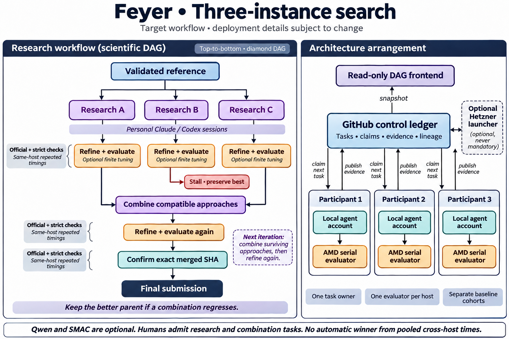
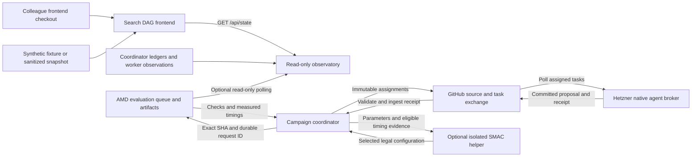

# Feyer architecture and collaboration briefing

**Working snapshot dated 21 November 2026. Subject to change, especially the AMD instance, Hetzner VPS, agent launch paths, service configuration, and location of the coordinator.** This describes the checked-in implementation and recorded deployment notes, not a fresh assertion that every described service is currently running. Treat source revisions, timestamps, and receipts as evidence; recheck deployment configuration before operational changes.

This briefing is for a colleague developing the frontend or integration alongside Tim without access to Tim's Hetzner VPS. You can build and test the entire frontend using the included synthetic fixture or a sanitized observatory snapshot. VPS access is needed for host administration and live agent execution, not for frontend development.

## Shared team workflow

The primary collaboration protocol is now the GitHub ledger on `control/team-search`, schema `feyer-team-search-v1`. Follow [the one-to-one workflow map and clone instructions](SEARCH_WORKFLOW.md): explore, refine the current incumbent, stop unproductive branches, combine compatible validated parents, refine again, and confirm the exact integrated SHA. The coordinator admits tasks; each participant claims work and uses their own agent account and AMD queue. Optional per-campaign controllers and the Hetzner broker remain supporting execution paths.

The CLI and recovery guards are integrated into the experiment repository and the control ledger is initialized. Provisioning/calibration of colleagues' additional AMD instances remains an operator step. Source availability, a successful task claim, an agent process, and a validated scientific result are distinct states.

## The part an AMD checkout cannot explain

AMD is primarily the evaluation host. The broader search also depends on coordinator state, GitHub assignments and receipts, authenticated agent processes, and an optional remote selection helper. Those records and services do not all live in the AMD checkout. Git branches may contain infrastructure that has not been integrated into the same revision deployed on AMD.

| Component | Responsibility | Recorded placement and changeable details |
| --- | --- | --- |
| Frontend | Read-only search DAG, results, evidence inspection | This repository; can run on either colleague's laptop. No host credentials. |
| Observatory API | Aggregate campaign ledgers, worker observations, historical reports, and optional queue results | `lab.live_dashboard` in the experiment repo; currently designed around the coordinator's local `.lab` directory. It is not automatically available on AMD. |
| Coordination | Human-owned shared task admission/claims and evidence; optional per-campaign frozen operators, budgets and selection | `control/team-search` is shared GitHub state. Personal operators and optional local Python campaign runners own execution. Placement can change. |
| Research executors | Run bounded Codex/Claude investigations; produce code or guidance | Local agent sessions and a native Codex broker on Hetzner. The inspected Hetzner adapter accepts Codex; it is not a general Claude broker. |
| Selector | Choose from admitted implementation configurations | Enumeration, local search, SMAC, or optional bounded Qwen proposals. SMAC can run in an isolated local environment or through the separate Hetzner helper. |
| Evaluator | Execute screen/full workloads, enforce recorded resource policy, retain artifacts | AMD shared queue and trusted worker. It owns numerical verdicts; agents do not self-certify results. |
| GitHub | Exchange source, immutable task inputs, candidate branches, claims, and receipts | `timbtz/feyer-search-lab`; the frontend is independently maintained in `timbtz/feyer-search-frontend`. |

This diagram shows communication, including feedback. The UI's scientific ancestry graph remains acyclic: a completed result informs a **new** candidate rather than creating an edge back into an existing ancestor.

## How larger research and smaller optimization fit together

1. A strong research agent investigates an algorithm, solver structure, or implementation topology. It operates in an owned branch/worktree, with a bounded brief and immutable starting commits. Its output may be notes only.
2. The coordinator reviews proposed operators and freezes a round specification: parameter domains, legal combinations, lanes, ownership, budget, and acceptance policy. A proposal does not silently expand the active search space.
3. A smaller search explores that admitted space. The inspected initial materializer exposes checkpointing, CSE prevention, and component mapping batch size. These are simulator implementation choices, not the 193 physical design variables. SMAC uses measured full results to rank configurations; it is a statistical selector, not an LLM.
4. The materializer produces an exact candidate commit. Scientific parents record the implementations chosen as inputs; Git parents record source-control ancestry. A combination keeps multiple scientific parents and receives its own evaluation.
5. The coordinator submits a durable request to AMD, first screening and then obtaining full validation where appropriate. Repeated measurements are distinct evaluation records for the same immutable candidate.
6. Results inform future selection, combinations, repair, or research guidance. A different operator topology needs review and a new admitted round.

The broader allocator and research strategy are evolving. Existing proposal/round/claim records are not evidence of an autonomous end-to-end research scheduler. Neither a clean merge nor a model's predicted gain establishes correctness or speed.

## Hetzner execution without sharing VPS access

The inspected broker implementation is `lab/host_broker.py` on the experiment repo's `infra/hetzner-agents` branch. These interfaces let a colleague understand the launcher without logging into the host:

| Exchange | Recorded convention | Meaning |
| --- | --- | --- |
| Assignment inbox | Branch `control/hetzner-assignments`, path `assignments/hetzner-codex-1/` | Operator-authored immutable tasks, not arbitrary issues or comments. |
| Assignment schema | `feyer-dag-task-v1`, output `feyer-dag-proposal-v1` | Task ID, campaign/round/spec identity, actor and claim version, parent SHAs, brief/context paths and hashes, allowed paths, model policy, and deadline. |
| Task claim | Branch `worker-claims/hetzner-codex-1/TASK_ID` | Atomic task ownership to prevent duplicate execution; separate from the coordinator's actor claim/version. |
| Work branch | `explore/hetzner/*` | An isolated branch/worktree for the assignment. Notes-only guidance cannot change the simulator. |
| Receipt outbox | `worker-results/hetzner-codex-1/TASK_ID`, `receipt.json` | Exact candidate/publication SHA, inputs, session/model/runtime evidence, changed paths, usage, and execution outcome. A successful proposal is still `not_evaluated`. |

The coordinator validates receipts, stale claims/rounds, allowed changes, and immutable identities before admission. The broker does not grant itself a new round, promote a candidate, or extend an assignment. Completed task files remaining in the inbox must not relaunch a task. Interrupted or uncertain coding turns require explicit recovery; replay is not a new authorization to spend time or tokens.

Recorded deployment uses native user systemd service `feyer-proposer.service`, account lingering, and a 30-second poll interval. No task means no model call. The notes describe one agent slot, a 2 GiB available-memory admission check, a 1.5 GiB service memory cap, no swap allowance, and one CPU equivalent. Runtime/state are under `/home/developer/feyer-agents/`. **These are changeable deployment settings, not frontend constants or current capacity guarantees.**

The account supplies its own existing Codex/GitHub authentication. Raw transcripts stay on the host; selected briefs, responses, and sanitized receipts are published through GitHub. One proposer invocation can include many provider requests; cumulative token counters are not one prompt's size or an inferred monetary charge.

A restricted Hetzner-to-AMD SSH connection was also documented for trusted queue RPC and bounded bundle upload. It is a separate capability, not a general shell or frontend API. The broker itself does not schedule physics evaluation. Host keys, gateway/source restrictions, service state, credential access, and instance replacement must be handled by the host owner; no keys, tokens, or private connection details are included here.

## AMD evaluation boundary

Both screen and full operate on the fixed 101-frequency, 193-variable, double-precision workload. Screening checks feasibility but omits the official finite-difference sanity check and the additional strict saved-array/all-gradient comparison. A screen pass is provisional.

Full evaluation runs the unchanged official benchmark plus the separate strict comparison. The two verdicts are distinct. A strict mismatch can require numerical review even when official checks pass. Infrastructure/transport failures must not be presented as scientific rejection.

The recorded evaluation policy is serial execution on one logical CPU, with CPU 2 affinity and a 32,000,000,000-byte sampled process-group RSS watchdog. This is not a kernel memory cap. GPU VRAM is separate from system RAM and is not used by these CPU benchmark runs. Keep the fixed benchmark environment isolated from controller/SMAC dependencies. Instance size, CPU identity, software versions, resource policy, and deployment paths must be rechecked after migration.

Rank complete first-run time, preserving compilation, setup, forward, sensitivity, gradient, transfer, and memory measurements. Compare matching cohorts; keep sample counts and variability. A valid result can be slower. A single fast run is not repeat-confirmed improvement; exact Pareto membership and a noise-qualified gain are different labels.

The source relay can push a branch and send an incremental Git bundle through the trusted client, pinning the exact submitted SHA on AMD. Durable request IDs allow queue lookup and idempotent retries. Do not independently resubmit a pending request because a browser or coordinator lost its connection.

## Data needed for the graph

The read-only snapshot is the frontend integration boundary. See [API contract](API_CONTRACT.md) and [the complete synthetic example](../fixtures/demo-state.json).

- `team_search`: shared tasks, one-owner claims, exact scientific inputs, candidate SHAs, instance/cohort observations and events. `team_search_source` distinguishes source freshness and connection failure from an empty ledger.
- `campaigns`: round specifications, lane ownership, candidate IDs/parents, parameters, provenance, model calls/outcomes, guidance, evaluation requests, eligible evidence, budgets, and source freshness.
- `workers`: observed provider/model, session/branch identity, direction, host label, status, timestamp, and staleness. A model name must be recorded rather than guessed from an actor label.
- `jobs` and `queue`: bounded read-only evaluation observations; remote results may arrive before the local ledger is reconciled.
- `historical`: earlier run records with their original evidence and comparability limits.
- `generated_at`: API snapshot time. It is not the source event timestamp or proof that an agent is alive.

Solid graph edges require recorded IDs or explicit historical branch identity. Dashed edges mean grouping, never scientific ancestry. Unresolved parents remain visible. Untested guidance stays untested. Candidate IDs are namespaced by campaign; a repeated SHA in another campaign is not automatically an ancestry edge. The frontend does not reconstruct the simulator's internal matrix/tensor graph from the search ledger.

## Working simultaneously

Your colleague can own this frontend repository, fixtures, layout, interaction, and API compatibility tests while Tim owns host operations and agent launches. Use separate branches/worktrees and agree the JSON shape before changing both sides. The frontend has no mutation controls and must not become a second coordinator.

For realistic UI work, Tim can provide a sanitized `/api/state` export. Store it in ignored `.local/`, not the repository. It is a static observation: do not label it as a live connection. For live integration, expose an approved read-only observatory endpoint through a separately arranged access path. A tunnel to AMD alone will not reveal coordinator ledgers or Hetzner sessions that were never exported there.

No VPS access is required to read the assignment schema, inspect authorized GitHub receipts, exercise synthetic failures, or develop the graph. GitHub access to both private repos is separate from VPS access and must be granted by their owner. Repo publication does not automatically invite collaborators.

Before operational changes, synchronize on the current coordinator owner/location, instance identity, queue contract, deployed broker/selector revisions, active budgets, and recovery responsibility. Adding a model, increasing concurrency, migrating hosts, admitting a new operator, or changing a JSON field can require corresponding adapter changes; it must not silently change frontend claims about running/validated work.

## Source anchors for this snapshot

These references pin implementation/documentation evidence. A source revision is not proof of the live deployed revision.

- [Experiment core at 5653295](https://github.com/timbtz/feyer-search-lab/tree/56532953f7cad39d05f82c8ea4409608f907dfd4): `lab/evolution.py`, `lab/evolution_run.py`, `lab/live_dashboard.py`, `lab/client.py`, `lab/worker.py`, and `.wiki/architecture.md`.
- [Hetzner broker and deployment notes at 464e266](https://github.com/timbtz/feyer-search-lab/tree/464e2665de12b2e73eeb8e8226f1ba8c5c14b938): `lab/host_broker.py`, `lab/evaluator_ssh_relay.py`, `ops/hetzner/`, `.wiki/hetzner-agents.md`.
- [Initial operator-owned assignment at 8449118](https://github.com/timbtz/feyer-search-lab/tree/8449118e42be7e1c3ea101d593c684c65375756e): task contract, brief/context, and ownership as published at that time.
- [SMAC integration](https://github.com/timbtz/feyer-search-lab/blob/56532953f7cad39d05f82c8ea4409608f907dfd4/.wiki/smac-search.md): optional isolated helper, frozen legal configurations, source/version checks, and training evidence rules.

Update this briefing with the source revision and deployment date when these arrangements change. Preserve uncertainty rather than turning an old host observation into current status.
