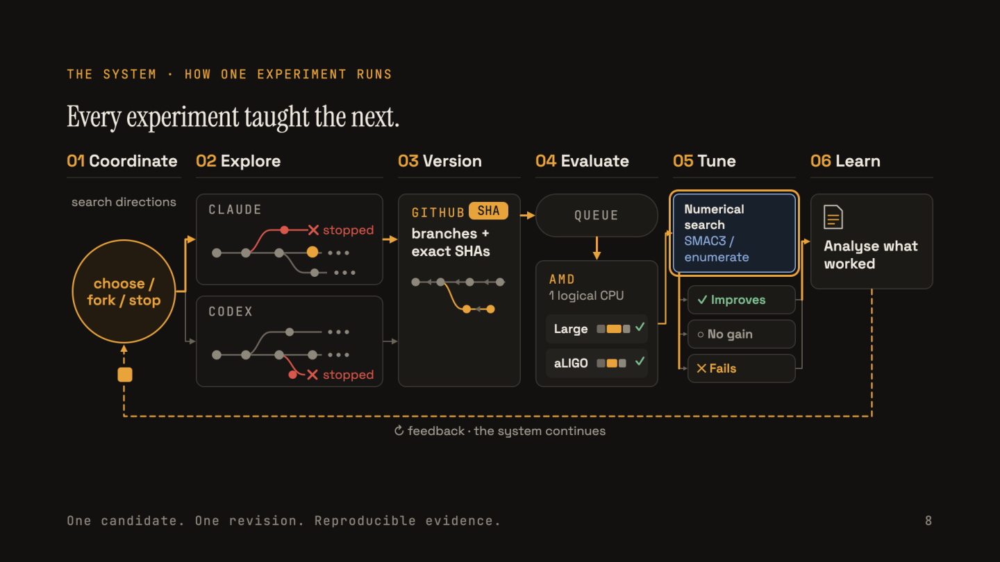

# Frontend guide

**The read-only frontend for the Feyer Search Lab: from a research idea to an exact revision and measured evidence.**

[Combined project overview](https://github.com/timbtz/feyer-search-lab#readme) · [Lab repository](https://github.com/timbtz/feyer-search-lab) · [Final presentation (PDF)](https://github.com/timbtz/feyer-search-lab/blob/main/presentation/faster-answers.pdf) · [Challenge (PDF)](https://github.com/timbtz/feyer-search-lab/blob/main/challenge.pdf)

[](https://github.com/timbtz/feyer-search-lab/blob/main/presentation/faster-answers.pdf#page=8)

The team optimized Differometor, an optical simulator, and built a Git-traceable operating loop to coordinate experiments. The final pitch reports a journey from 35.8 s to 0.66 s per complete first evaluation. The [results guide](https://github.com/timbtz/feyer-search-lab/blob/main/docs/RESULTS.md) separates those presentation milestones from exact lab candidates, validation results and measurement scopes.

## One project, two repositories

| Repository | Responsibility |
| --- | --- |
| **[feyer-search-lab](https://github.com/timbtz/feyer-search-lab)** | Operates the search: simulator, owned agent worktrees, exact Git revisions, task ledger, evaluator queue, validation, profiling and feedback |
| **feyer-search-frontend** — this repo | Explains the search: presentation, graph, candidate ancestry, exact-source dossiers, phase timings and run history |

The lab is the operating system; this frontend is its observatory. GitHub holds source and published evidence. Controllers and evaluator workers run the experiments. The browser reads observations and never launches agents, submits jobs, or changes results.

## Run locally

Python 3.9+ is sufficient; generated design-system assets are included. No model or evaluator account is needed.

```bash
git clone https://github.com/timbtz/feyer-search-frontend.git
cd feyer-search-frontend
python3 serve.py
```

Open <http://localhost:8770>. The default **Submission** view preserves the selected approximately one-second host/sparse candidate, `53f38d342c3228c052785e8c9d63b6ce9c832dd1`. Selection does not override recorded numerical findings. Open <http://localhost:8770/#story> for **Challenge & solution** and the final-pitch visuals.

The included `data/latest.json` is a **dated, sanitized snapshot**, not a live connection. Its [manifest](../data/manifest.json) records capture time, counts, candidate identities and the SHA-256 digest. This previously authorized export includes exact source differences, bounded evaluation logs and diagnostics; private agent conversations and credentials are excluded.

For an explicitly synthetic demo:

```bash
python3 serve.py --demo
```

Synthetic timings remain visibly labelled and are never research results.

## Find your way around

| View | What it answers |
| --- | --- |
| **Challenge & solution** | What was the challenge, how did the solution reduce time, and how do both repos fit together? |
| **Search map** | Which sessions, candidates, numerical searches and decisions are recorded? |
| **Overview** | What do the latest available observations say? |
| **Architecture** | How do proposal, evaluation, refinement, combination and confirmation connect? |
| **Timing profile** | Where did an exact job spend its first-run time? |
| **Results** | Which recorded candidates passed, and what comparisons are supported? |
| **Robustness** | What setup-generalization and JAX-interface diagnostics were recorded? |
| **Submission** | What changed in the selected source revision, and what evidence supports it? |
| **Run archive** | Where are individual jobs, repeated runs, failures, checks and retained logs? |

The original slide images are shipped locally. PDF links and the combined architecture guide point to the lab repository.

## Read the graph

**Topology map** groups recorded agent sessions and numerical menus. Expand a session to inspect its candidate revisions, then each screen/full job. Multiple sessions from the same agent remain distinct; ambiguous ownership stays unassigned. Disable **Group agent sessions** for individual candidates.

**Run cards** show a branch’s measured history, decisions and feedback. **Exact evidence DAG** shows declared scientific parents, combinations and optional evaluation nodes. Select a node to trace connections; use search, zoom and fit controls to navigate.

- Candidate ancestry uses explicit recorded parents, including every combination input.
- Grouping and lane membership organize the view without asserting ancestry.
- Operational feedback is a separate overlay; a group-level connection does not prove feedback reached a session.
- Repeated jobs remain attached to the exact SHA. Process completion, correctness, and improvement are separate states.
- Missing data is unknown. Comparisons retain instance, validation cohort and timing regime; the UI does not pool incompatible hardware results.

The graph represents research provenance and execution evidence, not the simulator’s internal tensor graph. [Combined architecture](https://github.com/timbtz/feyer-search-lab/blob/main/docs/ARCHITECTURE.md) explains the system; the [API contract](../docs/API_CONTRACT.md) defines its data.

## Connect to live lab observations

Start the lab observatory from a checkout containing the relevant local `.lab` records:

```bash
# In feyer-search-lab:
python3 -m lab.live_dashboard --repo . --port 8765
```

Then run this frontend:

```bash
python3 serve.py --api-url http://127.0.0.1:8765
```

The browser refreshes every five seconds while visible. Both servers bind to localhost; only `GET /api/state` is proxied. If the source becomes unavailable, the last successful view remains visible with a warning. A source timestamp does not prove that a worker is still active. Publishing this repository does not deploy a hosted dashboard or start an evaluator.

For another reviewed local snapshot:

```bash
python3 serve.py --snapshot .local/state.json
```

Keep incidental exports in ignored `.local/`. The tracked `data/` snapshot is an explicit publication exception, not a reason to commit new private exports. `npm run refresh:data` refreshes the approved snapshot from the configured source; inspect its changes before publishing. `npm run push:updated -- -u origin HEAD` refreshes and commits the data files before pushing and stops if refresh fails. Ordinary `git push` does not refresh data.

## Develop and verify

```bash
npm run check
npm test
python3 -m unittest discover -s tests -p 'test_*.py'
```

The app uses plain JavaScript, HTML, CSS, and Porsche Design System v4 pinned to `4.10.1`. Its generated assets are committed. Component chunks and fonts load from Porsche’s CDN; native fallback styling keeps the content and navigation usable offline. Regenerate intentionally with `npm ci --ignore-scripts` and `npm run build:pds`.

| Path | Responsibility |
| --- | --- |
| `index.html`, `style.css` | Project story, view structure and responsive presentation |
| `app.js` | Pure graph models, evidence transformations, layout and browser UI |
| `submission.js` | Exact source dossiers and searchable evaluation archive |
| `serve.py` | Local read-only snapshot/demo/proxy server |
| `story-assets/` | Original final-presentation slide exports |
| `fixtures/` | Explicitly synthetic example data |
| `tests/` | Graph, evidence-integrity, submission and server checks |
| `docs/` | Consumer contract, workflow and integration background |

Read [ARCHITECTURE_BRIEFING.md](../docs/ARCHITECTURE_BRIEFING.md) before changing integration behavior. Host placement, models and capacities in older briefings describe dated deployments. The embedded copy in the lab’s `lab/dashboard/` is synchronized deliberately; it is not an automatic mirror. Preserve each repo’s independent graph work when updating shared presentation assets.

Project code retains the [MIT license](../LICENSE). Porsche assets retain their separate [license](../PDS-LICENSE.md) and [third-party notice](../PDS-OSS-NOTICE); no Porsche logo or wordmark is used.
