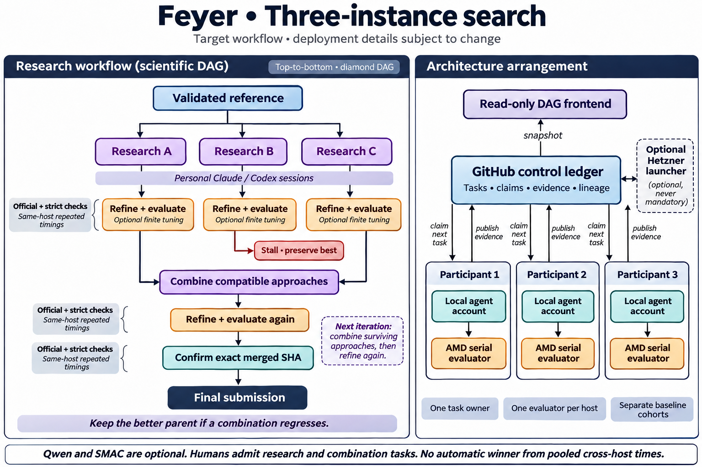

# Three instance search workflow

This is the intended research process mapped to the implemented GitHub task protocol. Deployment topology remains subject to change. Each participant runs their own Claude or Codex account and submits to their own AMD instance. Qwen, SMAC, and the Hetzner launcher are optional. The shared ledger coordinates humans and their agents; it does not automatically launch a fleet or authorize new compute budgets.



The image shows an example of fan-out and convergence. A stalled branch preserves its best implementation and can still supply a useful combination parent. Further combination/refinement iterations happen before final submission when justified. The live graph shows only recorded tasks and evidence, not hypothetical completed stages.

## Map each decision to a record

| Your workflow | Shared record and frontend representation | Gate |
| --- | --- | --- |
| Identify unexplored space and what needs improvement | Ready `explore` or `diagnose` tasks with hypothesis, exact starting SHA, priority, target mechanism, dependencies and budget | A coordinator admits the task; readiness does not mean an agent is running. |
| Three participants work in different directions | Each task has one durable claim, owner and instance; each writer owns a code branch/worktree | Only a successful current claim permits starting. The browser displays the queue but never claims it. |
| Strong LLM research develops a heuristic/topology | `explore` task with personal Claude/Codex and candidate commits | All physical workload and benchmark invariants remain fixed. No Qwen dependency. |
| Small optimizations improve that topology | A `refine` task pins the current best implementation as its parent and admits exactly one successor; a reviewed finite search can be delegated a separate explicit budget | Compare successor to incumbent, not merely to an older baseline. SMAC/enumeration are optional tools. |
| Decide whether further compute is justified | Same-instance/cohort repeated full observations and `assess`; preserve compile/runtime/memory descriptors | Default at least three full runs per candidate/parent. Useful gain must exceed the frozen absolute/relative/noise-range guard. |
| Stop a branch with no meaningful gain | Mark `stalled` with a reason and preserve its best validated SHA | Incomplete/noisy evidence needs confirmation; infrastructure trouble is `blocked`, not a scientific loss. |
| Combine two neighboring successful directions | New `combine` task with at least two distinct validated parent SHAs and overlap/compatibility notes | “Neighboring” means complementary mechanisms selected by the coordinator, not arbitrary graph proximity. A clean Git merge is not experimental validation. |
| Refine the combination again | Evaluate both parents and A+B on the same host, then create a new `refine` task from the useful combination | A+B must beat the better parent. If it regresses, retain the faster parent; never add speedups arithmetically. |
| Converge to one final solution | Repeat combinations where justified, choose a confirmation host, review the integration PR, and run the exact final merged SHA | `confirm` task completion alone does not crown a winner. Require full official and strict checks plus repeated comparable timing evidence before submission. |

The graph is a DAG rather than a spanning tree: combination nodes have multiple scientific parents. Git ancestry can differ after cherry-picks or reimplementation. A repeated implementation SHA is one scientific implementation, with separate observations on each instance/cohort.

## What is authoritative

[The experiment repository](https://github.com/timbtz/feyer-search-lab) contains the complete simulator, benchmark, submission code, evaluator, queue/client, controllers and setup. [The control branch](https://github.com/timbtz/feyer-search-lab/tree/control/team-search) contains `state.json` with schema `feyer-team-search-v1`, and a rendered README. It records tasks, claims, candidate branches, observations and events. Issues and PRs support discussion/review; they are not the task-claim authority.

Ordinary non-force Git pushes serialize ledger transactions. A losing concurrent claim reloads state and fails if another owner holds the task. Claims do not expire automatically. Retained code branches are checked again on reclaim, and recovery after a lost push response checks the current owner/claim/instance before reporting success. Do not force-push or manually edit ledger history.

## Clone and wire a participant

Use the checked-in commands and the [team runbook](https://github.com/timbtz/feyer-search-lab/blob/main/.wiki/team-search.md) and [AMD preparation runbook](https://github.com/timbtz/feyer-search-lab/blob/main/.wiki/portable-amd.md). The latter is for a new instance; it is not an instruction to overwrite an existing environment or restart another participant's worker.

```bash
git clone https://github.com/timbtz/feyer-search-lab.git
cd feyer-search-lab
gh auth login
python3 -m lab.team_search --help
```

Each participant chooses a unique actor/instance identity, prepares their own serial evaluator and local reference calibration, then uses this workflow with their actual values:

```bash
python3 -m lab.team_search --remote https://github.com/timbtz/feyer-search-lab.git --actor YOUR_NAME next
python3 -m lab.team_search --remote https://github.com/timbtz/feyer-search-lab.git --actor YOUR_NAME claim TASK_ID --instance YOUR_AMD_ID
```

Save the returned claim, create an owned worktree from the exact parent SHA, and give the task to the local Claude/Codex session. Reserve the committed candidate in the ledger, persist a durable evaluation request ID, submit through `lab.client` to the participant's queue, then record trusted terminal job JSON. Use `assess` before deciding to refine, stall, or combine. The runbook gives all command arguments, admission thresholds and recovery rules.

The initial team release requires CPU 2 and the fixed benchmark environment. It does not support silently accepting an alternative CPU or memory policy. Each machine has its own baseline/cohort and one serial evaluator. Three hosts can work in parallel; raw timings from their separate cohorts cannot be pooled to rank a winner.

## View the same workflow without VPS access

The frontend's **Team workflow** scope reads the shared ledger; **Campaign evidence** shows the separately recorded older/finite-search campaigns. These views do not imply that legacy workers were retroactively claimed in the team ledger.

For a static team export:

```bash
# In the experiment checkout; use your own actor name.
mkdir -p .lab/team
python3 -m lab.team_search --remote https://github.com/timbtz/feyer-search-lab.git --actor YOUR_NAME list > .lab/team/state.json
# In this frontend checkout, point at that reviewed local file.
python3 serve.py --team-snapshot /absolute/path/to/state.json
```

For live read-only updates, start the experiment observatory using your local GitHub authentication:

```bash
python3 -m lab.live_dashboard --repo /absolute/path/to/feyer-search-lab --port 8765 --sync-team
```

It polls only the fixed GitHub ledger every 30 seconds and retains the last successful snapshot if the connection fails. `--sync-remote` is a separate optional read-only connection to the operator's configured AMD queue. Without `--sync-team`, the observatory can read `.lab/team/state.json`; repeated browser reads do not make an old export fresh.

The independent frontend can use `python3 serve.py --api-url http://127.0.0.1:8765`, or `python3 serve.py --demo` with no infrastructure credentials at all. Missing data is shown as unavailable; it is not an empty queue or a successful deployment.

## Readiness and remaining operations

The team CLI, portable setup/preflight and claim-recovery fixes are integrated into the experiment repository. The shared ledger has been initialized. This establishes executable coordination and a read-only visualization; it does **not** establish that colleagues' two additional instances have been provisioned, calibrated or connected.

Each colleague must complete the new-instance runbook and publish trusted local reference evidence before claims on that host can support valid comparisons. Existing independent campaigns keep their original budgets and submission owners. Their observations can be imported deliberately; a new queue does not silently extend an old agent session or turn a single fast run into a confirmed final champion.

## Diagram source

The architecture illustration was created with the built-in image-generation tool and visually checked against this workflow. The final edit replaced the iteration annotation with “Next iteration: combine surviving approaches, then refine again.” Its full generation brief and edit prompt are recorded in [diagram generation notes](images/diagram-prompt.md). The textual protocol and actual evidence take precedence over the illustrative example.
